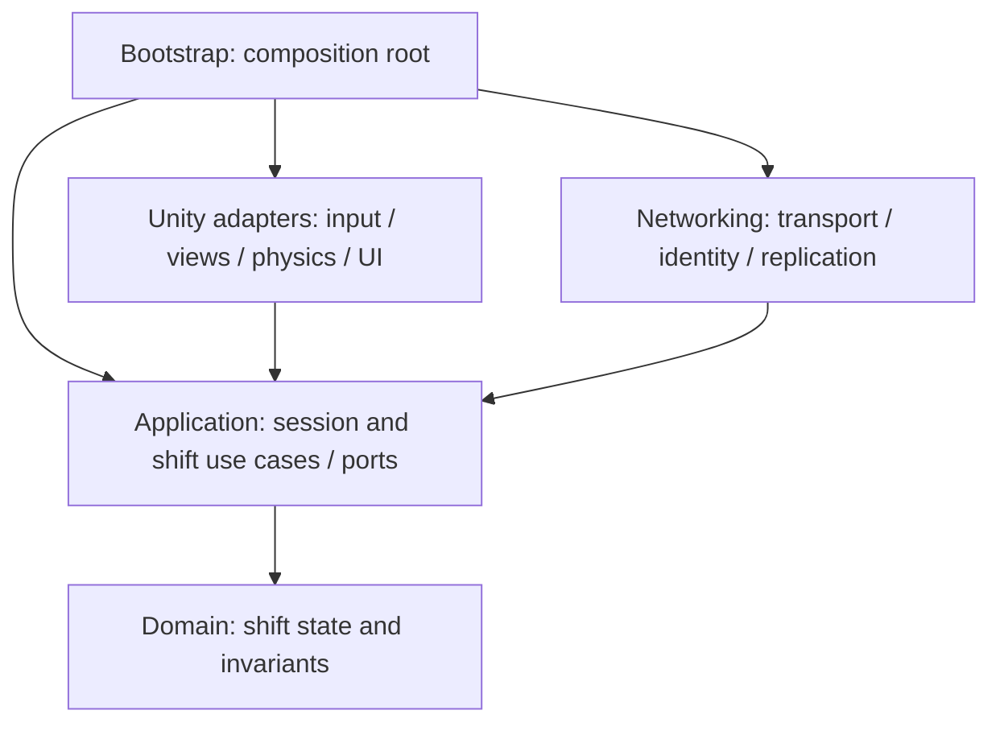

# Архитектура прототипа — ARCH-001

Статус: предложение для независимого QA и приёмки. Здесь нет реализации. Подтверждённые решения и открытые вопросы перечислены в [decisions.md](decisions.md).

## 1. Проверенная исходная база

Исследован клон `C:/Users/Artem/Desktop/Projects/game-moving-coop`, HEAD `84b61f3`. Unity-корень — вложенная папка `game-moving-coop/`. Все пути inventory ниже относительно корня репозитория.

| Наблюдение | Источник |
| --- | --- |
| Unity 6000.6.7f1, revision b22767f04f04 | `game-moving-coop/ProjectSettings/ProjectVersion.txt` |
| URP 17.6.0, Input System 1.20.1, uGUI 2.6.0, Pipeline 0.9.1-exp.1 объявлены прямыми зависимостями | `game-moving-coop/Packages/manifest.json` |
| Есть lock-файл; test-framework встречается среди транзитивных зависимостей. Это не доказательство настроенных или пройденных тестов | `game-moving-coop/Packages/packages-lock.json` |
| Единственная включённая сцена — SampleScene | `game-moving-coop/ProjectSettings/EditorBuildSettings.asset` |
| В SampleScene найдены Main Camera, Directional Light и Global Volume; камера имеет `orthographic: 0`. Готовой изометрической камеры нет | `game-moving-coop/Assets/Scenes/SampleScene.unity` |
| Собственные отслеживаемые C#-файлы Assets — Readme.cs и Editor/ReadmeEditor.cs шаблона; игровых скриптов не найдено | `git ls-files` и `rg --files game-moving-coop/Assets`; файлы в `Assets/TutorialInfo/` |
| Есть PC/Mobile RPAsset и Renderer, DefaultVolumeProfile, SampleSceneProfile, UniversalRenderPipelineGlobalSettings | `game-moving-coop/Assets/Settings/` |
| GraphicsSettings содержит пустой custom pipeline; QualitySettings содержит ссылки на Mobile/PC RPAsset, совпадающие с их meta GUID | `ProjectSettings/GraphicsSettings.asset`, `QualitySettings.asset`, `Assets/Settings/{Mobile,PC}_RPAsset.asset.meta` внутри Unity-корня |
| Фиксированный шаг записан как 0.02; `activeInputHandler: 1`; шаблонный InputSystem_Actions содержит карты Player/UI и действия Move, Look, Interact и другие | `ProjectSettings/TimeManager.asset`, `ProjectSettings.asset`, `Assets/InputSystem_Actions.inputactions` внутри Unity-корня |

Пакет в manifest не означает выбранную архитектуру. Сетевой стек не утверждён; отдельной прямой зависимости на игровую сетевую библиотеку в manifest не найдено. Unity Editor, сборка и клиенты в ARCH-001 не запускались. Существующая сцена и пакеты сохранены без изменений.

## 2. Границы и зависимости

Предлагаются пять небольших областей; сначала это границы ответственности и будущие папки, а не пять обязательных сборок. asmdef сейчас не создаются. Новые игровые материалы впоследствии можно держать в `game-moving-coop/Assets/Game/`, сохраняя шаблон отдельно.

Стрелка — зависимость исходного кода. Domain не знает Unity, transport, UI и Application. Application знает Domain и собственные небольшие контракты; Unity и Networking реализуют эти контракты и вызывают сценарии. Bootstrap связывает конкретные объекты. Обратный поток данных идёт через результаты и явно переданные получатели, а не через обратную зависимость Domain от UI.

| Область | Владелец и обязанности | Чего не делает |
| --- | --- | --- |
| Domain | ShiftState владеет фазой смены, предметами, участниками переноски и журналом зачётов. CargoState скрывает изменение своих полей за операциями ShiftState. Проверяет допустимые переходы | Не двигает Rigidbody, не посылает RPC и не читает сцены |
| Application | SessionCoordinator управляет подключениями и жизнью смены. ShiftCommands — единственный вход изменения смены; сериализует команды, проверяет полномочия, дедупликацию и вызывает Domain. Создаёт read-only результаты | Не содержит настройки рендера и конкретный сетевой API |
| Unity adapters | InputAdapter переводит действия в намерения; WorldAdapter связывает ID с объектами, симулирует физику на authority и сообщает наблюдения; Views/UI/Camera показывают подтверждённое состояние | Trigger и кнопка не начисляют деньги и не назначают носильщиков |
| Networking | Связывает соединение с участником, декодирует сообщения, доставляет команды и подтверждённые снимки/результаты. Клиентская копия доступна представлению | Не владеет отдельной конкурирующей копией правил квоты |
| Bootstrap | Создаёт и связывает конкретные зависимости, запускает/останавливает scopes | Не становится объектом со всеми игровыми правилами |

Обычные предметные классы остаются конкретными. Точки замены нужны у транспорта команд, чтения доверенных world observations и доставки результатов. На первом локальном срезе транспорт вызывает тот же Application непосредственно. Интерфейс для каждого класса, общий event bus, service locator и универсальный DI-контейнер не требуются. SOLID здесь — отдельные причины изменений, инкапсуляция инвариантов и зависимость правил от узких контрактов, а не количество абстракций.

## 3. Данные и контракты

Все имена ниже — рабочие обозначения, не готовый C# API.

| Вид данных | Владелец и время жизни |
| --- | --- |
| CargoDefinition / ShiftRules | Авторские конфигурации: тип, параметры переноски, базовая стоимость, цель. Возможны ScriptableObject-ассеты; при запуске копируются в неизменяемые domain data |
| ShiftState / CargoState / QuotaLedger | Обычные C# runtime-объекты только текущей смены. Изменяются на authority через ShiftCommands; наружу не выдаются изменяемые коллекции |
| Pose, velocity, контакты | Authority WorldAdapter владеет фактической симуляцией; Domain получает только необходимые факты, например доступность ручки или присутствие в зоне |
| MonoBehaviour views | Ссылки на компоненты сцены, визуальные эффекты, ввод, камера. Связь с domain — через ID и read-only снимок |
| Client replica | Подтверждённое состояние и presentation smoothing; не источник стоимости, участников или результата смены |

ScriptableObject подходит для разделяемых данных ассетов; это свойство Unity описано в [официальной документации](https://docs.unity.com/en-us/engine/6000.0/manual/scripting/get-started/fundamental-unity-types/class-scriptable-object). Запрет хранить в общем ассете текущую квоту или список носильщиков — наше проектное правило: новая смена получает новые runtime-объекты и не меняет исходную конфигурацию.

Контракты словами:

- **Команда:** версия протокола, SessionId, ShiftId, OperationId, ссылка на предмет/слот и параметры намерения. PlayerId берётся из привязки соединения на authority, а не из доверенного клиентского поля. Локальный ввод проходит ту же проверку.
- **World observation:** актуальная позиция/дистанция/контакт зоны, проверенная authority-адаптером для текущего шага. Клиент не присылает окончательные «я рядом» или «стоимость равна X».
- **Результат:** accepted / rejected, причина, OperationId, revision и затронутый read-only state. UI не вычисляет самостоятельный баланс.
- **Репликация:** первоначальный полный снимок и последующие версии состояния. Пропуск/неизвестная база требует повторного снимка. Старую revision нельзя применить поверх новой; поздний клиент получает ledger и состояние предметов из одного согласованного снимка.
- **Применение мира:** абсолютное желаемое состояние переноски/сдачи для предмета с revision. Повторное применение той же версии не создаёт второй joint, второй despawn или второй эффект зачёта.

SessionId задаёт конкретную игровую сессию, ShiftId — уникальную попытку смены. CargoId уникален среди runtime-экземпляров смены и не равен типу предмета или Unity InstanceID. Повторное создание того же типа получает новый CargoId; рестарт создаёт новый ShiftId, даже если используются те же authored spawn points. PlayerId — участник сессии; повторное подключение и восстановление его идентичности пока TBD.

OperationId — пара «идентификатор подключения/его поколения + возрастающий номер команды». Повтор с тем же ID и содержимым возвращает сохранённый результат; с другим содержимым отклоняется. На authority — ограниченное окно результатов и нижняя граница уже обработанных номеров: вытеснённая старая операция отклоняется, а не исполняется заново. Переставленные вне допустимого окна сообщения требуют повторной синхронизации; размер окна и гарантии доставки — задача сетевого spike. Idempotency не обещает исполнение каждой посланной команды: клиент обязан получить accepted или обработать отказ.

## 4. Authority, переноска и физика

Рекомендация для прототипа: один authority на сессию — процесс хоста либо отдельный сервер; конкретная топология ещё не выбрана. Он единолично изменяет domain state, состояние переноски, подтверждённые деньги и симуляцию груза. Право игрока держать ручку — игровое участие, а не передача ему сетевого авторитета Rigidbody.

Каждый authority-шаг: принять входящие намерения в очередь → привязать отправителя и проверить SessionId/ShiftId → обработать дискретные операции последовательно → применить желаемые физические связи → шаг физики → собрать доверенные факты для последующих решений → опубликовать согласованную revision. Trigger только ставит внутренний запрос в ту же очередь. Точный hook Unity и сетевой tick согласуются при реализации; пользовательские callbacks не должны менять domain напрямую и реентерабельно.

**Захват:** проверить активную смену, участника, предмет, свободную ручку, совместимость/лимит переноски и дистанцию по актуальному authority миру; затем одним переходом закрепить ручку. Два игрока на одну ручку — первая валидная операция в authority-очереди выигрывает, вторая получает занято. На разные ручки могут успешно встать оба, если правила разрешают. Нужное число носильщиков и эффект неполной команды — TBD.

**Движение:** игроки посылают намерение, authority объединяет ввод действующих носильщиков и задаёт физическую цель. Конкретная модель — силы/ограничения, кинематическое сопровождение или гибрид — проверяется spike. Запрещены независимые конкурирующие записи transform от нескольких клиентов. Сглаживание допустимо только как представление, результат столкновения подтверждает authority.

**Отпускание/disconnect:** удалить только участие соответствующего игрока, обновить ревизию переноски, пересчитать связи оставшихся. Если носильщиков не хватает, применить согласованную безопасную политику; для первого spike предлагается сбросить переноску и оставить груз в последней подтверждённой позе с authority-физикой. Повторное отпускание ничего не добавляет и не повреждает. После disconnect очередные команды старого соединения отвергаются; оно не сохраняет право на ручку.

WorldAdapter проверяет возможность применения связей до domain commit, но не изменяет мир во время такой проверки. После commit применяет желаемое состояние идемпотентно. Если применение неожиданно не удалось, не возвращать успешную картину физики: остановить обработку взаимодействий затронутого предмета, восстановить проекцию из authority state либо явно прервать смену с диагностикой. Детали политики отказа должны попасть в реализацию; «тихо продолжить» запрещено.

Мы не строим lockstep и не предполагаем одинаковую физику клиентов. Unity описывает влияние переменного шага на воспроизводимость в [Physics.Simulate](https://docs.unity.com/en-us/engine/6000.0/script-reference/unityengine/physics/simulate). Фиксированный шаг сам по себе здесь не принимается доказательством сетевой детерминированности; его достаточность для этой игры не проверялась.

## 5. Сдача, квота и завершение

Предложение базового правила для spike: предмет, полностью принятый точкой сдачи по authority-проверке, становится терминально Delivered и больше не используется. Что значит «принят» — размещение/кнопка/закрытие грузовика — TBD; форма команды не должна закреплять дизайн преждевременно.

1. В authority-очереди запрос сдачи проверяет активность ShiftId, право инициатора либо внутренний источник зоны, существование CargoId, отсутствие Delivered и фактические условия сдачи. Стоимость берётся из правил и подтверждённого состояния предмета.
2. Domain готовит новый state без побочных эффектов: освобождает ручки, ставит Delivered, добавляет запись ledger по ключу `(ShiftId, CargoId)` и изменяет total в целых денежных единицах с проверкой диапазона. Любой отказ оставляет прежнее состояние полностью.
3. В одном commit заменяется всё состояние этой операции, увеличивается revision и сохраняется результат OperationId; только затем публикуется результат. Другой запрос не вклинивается между Delivered и начислением.
4. Физическая/визуальная проекция отключает повторное взаимодействие и применяет состояние сдачи. Дубликат события или новый OperationId на уже Delivered не начисляет деньги. Защита ledger нужна независимо от сетевой дедупликации.

Квота отображается из ledger, а не из суммы триггеров. Правило успеха проверяется после commit. Подсчёт может превысить цель, но числовые пределы и точное правило завершения должны быть утверждены. Перекрывающиеся зоны сдачи не создают два зачёта.

Фазы предложения: Preparing → Active → Settling → Finished → Disposed. При завершении authority запрещает новые игровые команды, завершает принятую до границы операцию, фиксирует итог и публикует один результат смены. Команды за границей отклоняются. Для одинакового шага порядок завершения/сдачи задаёт authority-очередь; точное правило таймера — TBD.

Квота смены и постоянный кошелёк не отождествляются. Постоянная экономика не утверждена. Если позже появится выплата, ей нужен отдельный ledger по ShiftId с однократным settlement, включая повторный запрос результата. Текущий in-memory commit не даёт сохранности при падении процесса и не является транзакцией облачного хранилища.

## 6. Composition root и lifecycle

Предлагаемый Bootstrap — один явный владелец SessionCoordinator. Он получает сериализованные ссылки на authoring-объекты сцены, проверяет их и создаёт конкретные зависимости без глобального поиска сервисов.

1. При входе создаёт session scope: транспорт либо локальный адаптер, привязки соединений, command ingress и получателей результатов. Authority назначается явно до приёма команд.
2. Для смены создаёт новый ShiftId, снимок правил, ShiftState, очередь, dedup window, world bindings и подписки представления. После регистрации всех CargoId и проверки сцены включает Active/input.
3. Компоненты получают зависимости через явную инициализацию. Не опираться на случайный порядок Awake разных объектов: Unity предупреждает об ограничениях порядка одинаковых callbacks у разных объектов в [Execution order](https://docs.unity.com/en-us/engine/6000.0/manual/scripting/managing-update-order/execution-order).
4. При выходе сначала закрывает ingress и ввод, отменяет отложенные callbacks/загрузки с маркером поколения смены, снимает физические связи, отписывает UI/world listeners и освобождает shift scope. Dispose повторяем и безопасен; отключение view не должно самовольно завершать чужую сессию.
5. Restart — закрыть старую смену, отбросить её очередь, очистить ledger/связи/реплики, создать новый scope и ShiftId. Старая команда или callback со старым ShiftId отвергается, даже если CargoId совпал. SessionCoordinator может сохранить соединения, но не runtime-состояние старой смены.
6. Закрытие сессии освобождает и транспорт. Для потери authority предлагается явное завершение/разрыв сессии; миграция хоста, восстановление после краша и reconnect не входят автоматически в прототип и требуют отдельного решения.

## 7. Будущие проверки и расширения

Проверки ниже — критерии будущих задач, сейчас не выполнены.

| Уровень | Обязательные примеры |
| --- | --- |
| Domain без Unity | Два захвата одной ручки дают одного владельца; повторный release безопасен; неверный переход не меняет состояние; Delivered и ledger/total всегда согласованы; диапазон суммы не переполняется |
| Application с подставным world/transport | Поддельный PlayerId игнорируется; старый ShiftId отвергается; повтор операции возвращает прежний результат; изменённое тело того же ID отвергается; старый ID вне окна не исполняется; конкурирующие сдачи дают один зачёт |
| Unity integration | Привязки CargoId уникальны; дверь/стены не скрывают действие; связи создаются и снимаются однократно; несколько colliders и зон не дублируют сдачу; отказ world projection диагностируется; два запуска смены не накапливают подписки |
| Два клиента с authority | Разная задержка и перестановка сообщений; захват одной/разных ручек; disconnect во время переноски; сдача одновременно с отпусканием/концом смены; рестарт при командах в пути; полный снимок не расходится с ledger; потеря authority заканчивается явно |

До игровых тестов нужны отдельная авторизация, выбранные инструменты и сценарии. Документ не обещает качество физики или сетевой стек по результатам статического проектирования.

| Расширение | Что меняется и что должно остаться стабильным |
| --- | --- |
| Новый тип груза | Definition, view/физические параметры; контракт команд и однократный ledger прежние. Новое поведение требует отдельного компонента/правила, не ветки по каждому имени префаба |
| Инструмент, например тележка | Новый сценарий Application, правила крепления и Unity adapter; весь доступ проходит authority. Возможна переработка модели ручек после spike, обещания нулевых изменений нет |
| Опасность или повреждение | Authority-наблюдение → новая domain-операция; policy стоимости читает подтверждённое состояние. Transport переносит новое состояние с версией; UI не определяет ущерб |
| Другое правило квоты/стоимости | Меняются правила расчёта и будущие domain-тесты; сдача, ID и ledger сохраняют инварианты. Общий policy-интерфейс нужен только при реальной альтернативе |
| Замена сетевой библиотеки | Networking/Bootstrap и world replication интеграция меняются; предметные правила сохраняются. Prediction, сериализация и физический tick могут потребовать переработки adapters |

Ближайший следующий шаг после приёмки и отдельного поручения — минимальный срез управления/камеры, затем ранний сетевой эксперимент с одним грузом. Сначала измерить конфликтующие захваты и поведение физики, затем закреплять подробную модель переноски.
